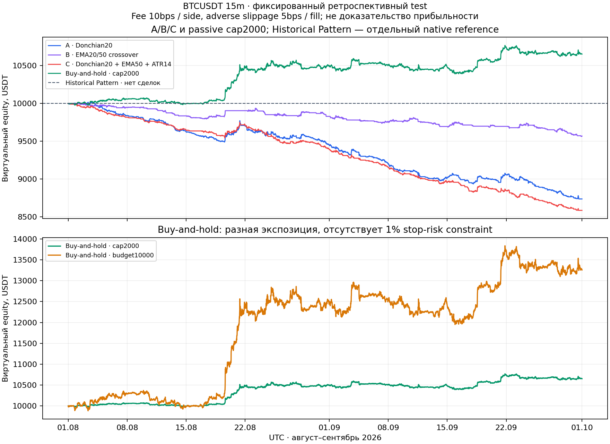

# Фиксированное offline-сравнение BTCUSDT 15m, май–сентябрь 2026

## Результат

**COMPLETE**: расчёт выполнен на доступном пользовательском CSV, без запросов
за котировками и без синтетических свечей в оценке доходности. A/B/C убыточны
в development и в тестовом августе–сентябре при зафиксированной модели издержек.
Buy-and-hold положителен в тесте, но имеет иной риск и только одну сделку.
Production Historical Pattern не создал подтверждённых сигналов и экспозиции.
Это не основание объявлять какую-либо стратегию прибыльной или production-ready.

Протокол сохранён **до расчётов**, без оптимизации:
[FIXED_STRATEGY_PROTOCOL.json](FIXED_STRATEGY_PROTOCOL.json), SHA256
`3bd6063ba598381d6a4838f61a841ea89fd650474d60dce7d656c6020b4e9a86`.
CLI проверяет hash и отказывается считать при изменении протокола.
Подробные правила: [FIXED_STRATEGY_RULES.md](FIXED_STRATEGY_RULES.md).
Конкретный вариант B не переворачивается немедленно: opposite cross закрывает
позицию next open, сигнал противоположного входа при занятой позиции игнорируется.
Вариант C использует close выше/ниже EMA50, а не slope-фильтр EMA50.
Результаты относятся именно к этим заранее описанным вариантам.

## Данные, split и прогрев

Исходный `BTCUSDT-15m-2026-05_to_09.csv`: **14688** свечей, 12 колонок,
без заголовка; все 14688 open timestamps имеют 16 цифр (microseconds).
Существующий CSV importer проверил open/close timestamps, типы, OHLCV,
положительные цены, nonnegative volume, порядок, дубликаты и пропущенные
интервалы. Пропусков, дубликатов и исправленных/выдуманных строк нет.
SHA256 исходного файла:
`cbe142f776e2ddebe66b5e33a601ac679cf1988ad9b16b52799bc336fac1cb07`.
Источник заявлен пользователем как Binance; независимой сетевой проверки
подлинности CSV не проводилось.

Заранее фиксированный development: `[2026-05-01,2026-08-01)` UTC.
Первые **500** свечей — только warm-up; фактическая development-performance
начинается `2026-05-06 05:00 UTC`. Обработано **8332** development свечи.
Test: `[2026-08-01,2026-10-01)` UTC, **5856** свечей (2976 август + 2880 сентябрь).
Test использует 8832 прошлые свечи для причинных индикаторов/истории и новый
ledger с 10000 USDT. Development позиции и cashflows не переносятся.
Между августом и сентябрём позиции/капитал продолжаются. Сигнал предыдущего
сегмента не исполняется на первом test open. Календарная граница используется
вместо default 70% split Strategy Lab; `baseline.development_pct` в JSON
помечен как ignored, он не определяет границы этого исследования.

Август и сентябрь уже изучались в предыдущих задачах. Поэтому этот test —
**ретроспективно зафиксированный holdout**, а не ранее не просмотренная слепая
валидация. Май–июль используется для development-сравнения, но параметры
не обучаются и не выбираются по результатам ни одного сегмента.

## Общий engine и условия

A/B/C используют неизменённый `app.lab.execution.simulate`, существующие
causal EMA/Wilder ATR, CSV loader и Decimal helpers. Никакой дублирующий
торговый/accounting engine для активных стратегий не написан.
Research-only настройки: starting10000 USDT, fee10bps per side (0.10%),
adverse slippage5bps per fill (0.05%), stop-risk budget≤1%, max notional2000,
max positions1, виртуальный collateral1x для LONG/SHORT. Комиссии/проскальзывание
— assumptions, не утверждение о тарифах биржи или реальных Render settings.

Сигналы вычисляются на close, entry и strategy exit — **next open**.
A/B SL/TP distances равны 2%/4% signal close, C — 2ATR14/4ATR14; расстояния
центрируются на actual entry fill. Protective opening gap имеет приоритет
над запланированным strategy exit на том же open; последующее intrabar движение
не подменяет уже выполненный open exit. При двойном касании SL/TP выигрывает
SL, stop-gap хуже stop, target-gap capped на target. Slippage применяется
adversely ко всем fills. Позиции принудительно закрываются только на final close
каждого сегмента; все A/B/C и buy-and-hold сделки поэтому CLOSED в отчёте.
Известен OHLC range, не tick path: protective exit timestamps — proxy candle close.

Размер — минимум fee/slippage-inclusive risk capacity, notional cap и
cash/collateral capacity; quantity floor12, fees ceil8, деньги/PnL round-half-even8,
арифметика Decimal64. **1% — общий верхний бюджет**, не фактический одинаковый
расход риска. В тесте planned stop risk A/B около45 USDT, C min7.54/mean14.44/
max33.89 USDT: cap2000 часто ограничивает позицию раньше risk budget100.
Реальный виртуальный stop-gap может превысить planned stop risk.
Сравнение не объявляется сравнимым по равному фактическому риску каждой сделки.

## Development: май–июль после прогрева

| Вариант | Закрытые сделки | Win rate | Profit factor | Net PnL USDT | Return | Max DD | Final equity |
|---|---:|---:|---:|---:|---:|---:|---:|
| A Donchian20 | 271 | 19.5572% | 0.30472652 | -2585.50206801 | -25.8550% | 26.3081% | 7414.49793199 |
| B EMA20/50 cross | 78 | 28.2051% | 0.64483175 | -353.24713292 | -3.5325% | 4.6861% | 9646.75286708 |
| C Donchian+EMA50+ATR | 381 | 22.5722% | 0.29336267 | -2792.79768492 | -27.9280% | 28.1397% | 7207.20231508 |
| Buy-hold cap2000 | 1 | 0% | 0 | -458.62486983 | -4.5862% | 5.9999% | 9541.37513017 |
| Buy-hold budget10000 | 1 | 0% | 0 | -2290.83351562 | -22.9083% | 29.6481% | 7709.16648438 |
| Historical Pattern native | 0 | undefined | undefined | 0 | 0% | 0% | 10000 |

## Test: август–сентябрь

| Вариант | Закрытые сделки | Win rate | Profit factor | Net PnL USDT | Return | Max DD | Final equity |
|---|---:|---:|---:|---:|---:|---:|---:|
| A Donchian20 | 187 | 17.6471% | 0.38088293 | -1262.57279693 | -12.6257% | 12.7741% | 8737.42720307 |
| B EMA20/50 cross | 65 | 16.9231% | 0.38800164 | -431.00138442 | -4.3100% | 4.3952% | 9568.99861558 |
| C Donchian+EMA50+ATR | 249 | 24.0964% | 0.36956601 | -1413.18321096 | -14.1318% | 14.1374% | 8586.81678904 |
| Buy-hold cap2000 | 1 | 100% | undefined, no losses | +652.13552412 | +6.5214% | 1.9116% | 10652.13552412 |
| Buy-hold budget10000 | 1 | 100% | undefined, no losses | +3257.42020045 | +32.5742% | 7.8033% | 13257.42020045 |
| Historical Pattern native | 0 | undefined | undefined | 0 | 0% | 0% | 10000 |

Final balance=equity для A/B/C и buy-hold после terminal liquidation.
Buy-hold primary использует cap2000 и оставшийся cash; classic10000 имеет
намного большую экспозицию (actual notional меньше10000 из-за entry fee).
Ни у одного buy-hold варианта нет SL или 1% stop-risk constraint, поэтому
passive benchmark не является risk-equivalent. Win rate100% по одной сделке
не доказательство надёжности; profit factor без проигрышей не превращён в infinity.

### Сигналы и издержки в test

| Вариант | LONG / SHORT / WAIT | LONG/SHORT сделки | Fees USDT | Slippage attribution USDT |
|---|---:|---:|---:|---:|
| A | 306 / 254 / 5296 | 106 / 81 | 748.15343273 | 374.07668085 |
| B | 64 / 64 / 5728 | 24 / 41 | 260.17199112 | 130.08598523 |
| C | 297 / 244 / 5315 | 141 / 108 | 996.18482015 | 498.09242969 |

Candidate signal не равен entry: сигналы при занятой позиции игнорируются,
нет next open для последней свечи сегмента. C имел32 `TARGET_AFTER_COSTS`
отказа в test и1 в development: planned net target reward после fee/slippage
не положителен. A/B risk/stops rejection counters пусты. Комиссии материальны,
особенно при частых C-сделках; параметры для улучшения результата не менялись.
Slippage уже включён в fill prices/PnL; его нельзя вычитать второй раз.

## Помесячная статистика A/B/C

Closed PnL включает обе комиссии сделки и относится месяцу её закрытия.
При переносе позиции entry fee может относиться другому месяцу. Поэтому отдельно
сохраняются cashflow PnL и equity change: первое сверено с balance change,
второе учитывает unrealized exposure. Open fills относятся UTC-месяцу open;
intrabar/final-close exits — месяцу закрывшейся свечи (`exit_time-1s` только
для attribution, сам trade timestamp не меняется). Monthly DD локален с
baseline предыдущего close; whole-segment DD использует все глобальные peaks.

| Вариант / месяц | Закрыто | Win rate | PF | Closed net PnL | Cashflow PnL | Equity change | Monthly DD |
|---|---:|---:|---:|---:|---:|---:|---:|
| A май, после warm-up | 76 | 19.7368% | 0.29542943 | -600.5194 | -600.5194 | -600.5194 | 6.1989% |
| A июнь | 97 | 19.5876% | 0.37489138 | -1005.7752 | -1007.7752 | -1019.9538 | 12.5370% |
| A июль | 98 | 19.3878% | 0.22124621 | -979.2074 | -977.2074 | -965.0289 | 11.9061% |
| A август | 97 | 21.6495% | 0.42132228 | -546.2205 | -548.2205 | -551.9211 | 5.6796% |
| A сентябрь | 90 | 13.3333% | 0.34603616 | -716.3523 | -714.3523 | -710.6517 | 7.6127% |
| B май, после warm-up | 24 | 33.3333% | 0.87986950 | -29.5302 | -31.5302 | -42.5900 | 1.1570% |
| B июнь | 31 | 19.3548% | 0.38572509 | -304.5255 | -302.5255 | -291.4658 | 2.9472% |
| B июль | 23 | 34.7826% | 0.92415230 | -19.1914 | -19.1914 | -19.1914 | 1.6583% |
| B август | 33 | 15.1515% | 0.46977807 | -170.5885 | -170.5885 | -170.5885 | 2.0863% |
| B сентябрь | 32 | 18.7500% | 0.31922141 | -260.4129 | -260.4129 | -260.4129 | 2.8051% |
| C май, после warm-up | 111 | 23.4234% | 0.25572899 | -725.5101 | -725.5101 | -725.5101 | 7.3754% |
| C июнь | 138 | 22.4638% | 0.32852065 | -1188.4300 | -1188.4300 | -1188.4300 | 13.2360% |
| C июль | 132 | 21.9697% | 0.27221288 | -878.8576 | -878.8576 | -878.8576 | 11.0338% |
| C август | 125 | 28% | 0.43450138 | -601.1904 | -603.1904 | -606.8910 | 6.0689% |
| C сентябрь | 124 | 20.1613% | 0.31098774 | -811.9928 | -809.9928 | -806.2923 | 8.5898% |

Полные monthly entry/exit counts, fees, balances/equity, win rate/PF/DD для
всех пяти сравнительных рядов находятся в JSON. Для passive benchmark monthly
equity changes (cap2000 / budget10000): май −193.9056/−968.5596, июнь
−369.3446/−1844.8784, июль +104.6254/+522.6045; август +492.0973/+2458.0284,
сентябрь +160.0382/+799.3918 USDT. Passive trade реализуется только в конце
сегмента, monthly win rate/PF до закрытия undefined.

## Production Historical Pattern — отдельная проверка

Использованы неизменённые PatternConfig(), SignalReader, Auto и Paper Engine,
через существующие causal prefix cache и production backtest helpers. Native
entry — verified closed-candle **close**, slippage не поддерживается, final
forced close не добавлялся. Поэтому original HP **не ранжируется** как
эквивалент next-open модели A/B/C. Мы не меняли execution semantics ради сравнения.

Development: 8332 WAIT; test: 5856 WAIT, LONG=SHORT=0. В обоих сегментах entries,
closed/open positions и fees=0, balance/equity10000, PnL/DD0, win rate/PF undefined.
Каждый сигнал успешно вычислен: decision_counts только `NO_SIGNAL`, технических
отказов нет. MINIMUM_SAMPLE, CONFIDENCE и WILSON не прошли ни одну свечу
(8332/5856 отказов соответственно); причины перекрываются, их нельзя складывать.
PAPER_SETTINGS risk/SL/TP до entry не доходили. Нулевой результат — отсутствие
экспозиции, а не доказательство качества стратегии.

Native test имеет **8832**, не10000 initial warm-up bars, затем накопление
архива. Development начинается с500, поэтому не воспроизводит live архив Render.
Defaults10000/risk1/max2000/fee0.10/SL2/TP4/max1/PAPER_SETTINGS явно отделены
от неизвестных persisted Render settings. Native monthly rows используют
close/event UTC; последнее July/September решение может иметь timestamp
Aug1/Oct1. Это закрытие предыдущей свечи, не leakage следующего месяца.
Native curve хранит только baseline, поскольку пустые ticks без позиции не
создают points. Пунктир на рисунке — математически постоянный ledger без
сделок, не выдуманная история рыночных observations.

## Полные сделки и equity curve

[FIXED_STRATEGY_RESULTS.json](FIXED_STRATEGY_RESULTS.json) содержит все **1235**
closed trades сравнительных моделей: entry/exit time, raw/fill price, side,
quantity/notional, защитные уровни, risk, fees, slippage и fee-inclusive PnL;
полные curves и monthly rows. Для A/B/C each test curve содержит5857 points,
не только последнюю UI-выборку. Native decisions сохранены отдельно полностью.
График test: [FIXED_STRATEGY_EQUITY.png](FIXED_STRATEGY_EQUITY.png).



SHA256 JSON: `4d85cd9c0f90c5d0ca8ccbe18cdbe9807ef1cce545230f2bbd1786dab0ad3a38`.
Pre-research main revision: `12d726c6c603cdadda609dc87eeca90edc295593`.
Code hashes, frozen protocol, parameters, source hash и Python version сохранены
в JSON. Неизменённые исходные Lab и native HP файлы проверены по Git blob hashes.

## Воспроизведение и ограничения ресурсов

```bash
python -B scripts/offline_fixed_strategies.py \
  /path/to/BTCUSDT-15m-2026-05_to_09.csv \
  --sandbox-poll --max-seconds-native-split 900 \
  --output /tmp/aura-fixed-offline.json
```

Output должен быть новым. `--sandbox-poll` — существующий явный offline
selector wakeup workaround, production loop не меняется. CPU budget experimental
120s, native≤900s per split в выполненном запуске (CLI cap1800s), timeout60s
в production SignalReader. CSV ограничен существующими16MiB/20000 rows,
offline путь не использует Lab UI/API cap12000 или live chart cap2000 и не
снимает их. Веб-job, новые endpoints, live SQLite или paid storage не добавлены;
запускать отдельно от Render worker. Матplotlib уже был установлен и использован
только для диагностического PNG, runtime dependencies не менялись. Curves
позволяют построить свой график непосредственно из JSON.

## Проверки и review

- Полный Python suite: **748 passed**, одна existing Starlette deprecation warning.
- Новые tests: **13 passed** — future perturbation каждого A/B/C, Donchian
  current-high exclusion, EMA event vs alignment, независимый ATR constant-TR
  oracle, frozen protocol mismatch, next-open/pre-entry OHLC, LONG/SHORT
  conservative ambiguity, passive fees/equity/monthly и split/reproducibility.
- Все JavaScript suites: **101 passed**, 0 failed. Syntax/import, heuristic
  credential и exchange-write scans PASS. Browser/Render/Android **NOT RUN**.
- Real-data independent checks: все experimental runs повторены с точным
  совпадением reports; signed Decimal PnL/ceil fees/slippage независимо
  восстановлены из raw/fill prices и quantity. Entry/exit сверены с CSV,
  risk≤budget/notional≤2000 проверены каждой A/B/C сделке. Final balance,
  полный peak-to-trough drawdown и monthly cashflow sums сверены независимо.
- Native direct/cache equivalence проверена на real indices499,500,8831,8832,
  14687; SignalReader проходит неизменённые cutoff/source/tail checks, outcomes
  и MTF видят только prefix. Все14188 native решения — computed WAIT.
- Architecture/security pass: только новые standalone diagnostic files,
  нет активации стратегий, private execution client, exchange writes или ключей;
  существующие production/Auto/UI/риски/интеграции не менялись. Tests synthetic
  fixtures не использованы как performance evidence. Подтверждённых ошибок,
  требующих исправления production в этой задаче, не выявлено.

Среда: Python3.12, FastAPI0.141.1, uvicorn0.52.1, httpx0.28.1, websockets16.0,
NumPy2.3.5. Exact pinned dependencies не переустанавливались; optional
ruff/mypy/bandit/coverage не запускались. OHLC не определяет intrabar path,
реальную ликвидность, latency, spread/funding, частичное исполнение и outages.
Fixed slippage — model assumption, не реалистичная биржевая гарантия.

Следующий исследовательский шаг требует нового заранее объявленного периода,
предпочтительно ранее не просмотренного. По текущим данным нет основания
активировать A/B/C, менять production или оптимизировать параметры под test.
